# tv-home — family edition (Xiaomi Android TV 10)

This fork of [mihirgupta0900/tv-home](https://github.com/mihirgupta0900/tv-home) takes the same idea
(debloat an Android TV over Wi-Fi and replace its ad-filled home screen with a small, fast launcher)
and adds what a family with young children needed:

- **A family calendar as the default screen.** When nobody has typed a PIN, the TV shows the shared
  Google calendar (week, day or month), read-only, instead of apps.
- **Adult and Kids profiles with a 6-digit PIN.** Kids see only an allow-list of apps, for 30, 60 or
  90 minutes chosen by an adult, with a 5-minute warning; then the TV goes back to the calendar.
- **A PIN gate on everything else.** Outside the Adult profile, any app off the kids' list (opened
  from the remote's Mi key, voice search, the Play Store or anywhere else) asks for the PIN, and so
  do Settings and the Play Store. YouTube asks for it in every profile.
- **New calendar events by voice**, in Brazilian Portuguese: "dentista amanhã às 10" becomes an event
  after a confirmation screen. Listening stops by itself after 3 seconds of silence.
- **Windows tooling**: build, install, apply and restore from Git Bash / MSYS2 with plain `adb`.

Everything is reversible: packages are disabled, never uninstalled, and
[`tools/restore-windows.sh`](tools/restore-windows.sh) was tested to bring the stock setup back.
No root. The UI text is in Brazilian Portuguese (the family's language); this README is in English.

Tested on a Xiaomi Mi TV (`MiTV-MOOQ0`, Android TV 10, MediaTek, build QTG3.200305.006).
All screenshots below were taken from the TV over ADB; calendar entries, the Wi-Fi name and the
Google account avatar are blurred.

## Screenshots

**Before: the stock Google launcher** (sponsored hero, "best-selling movies" rows, recommendations).
Promotional artwork blurred.

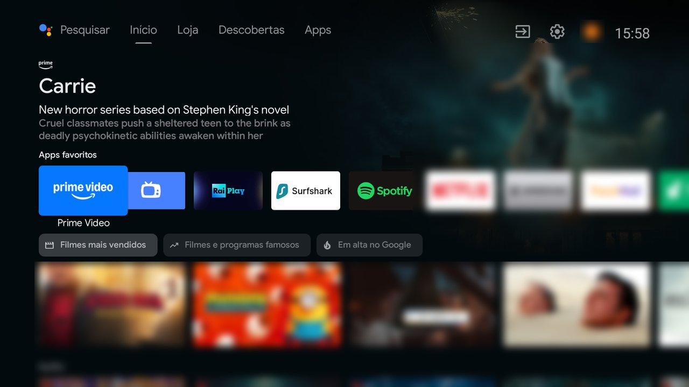

### Locked: the family calendar

| Week view, shown when the TV turns on | Adults' PIN pad (6 digits, remote number keys work) |
|---|---|
| 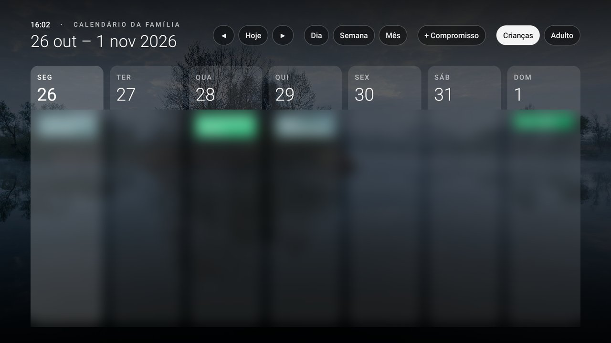 | 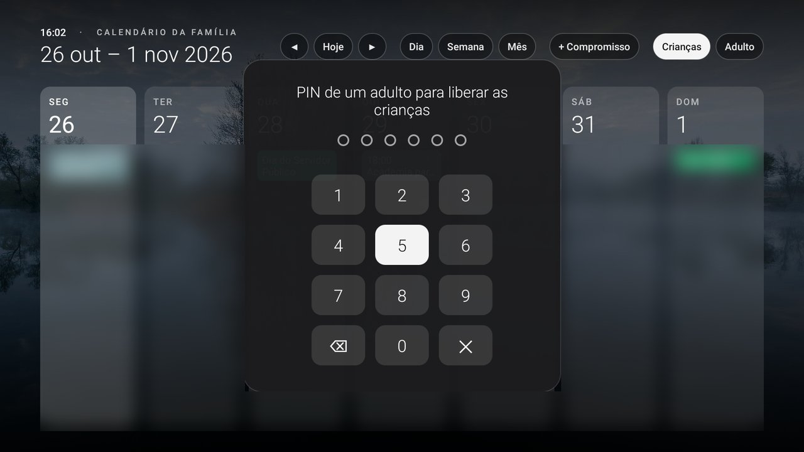 |

| Month view | Day view |
|---|---|
| 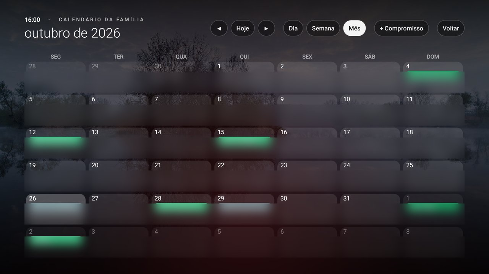 | 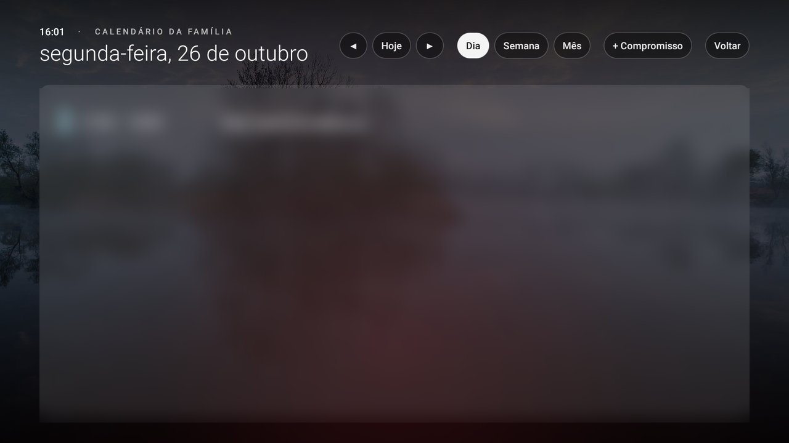 |

| New event by voice (stops after 3 s of silence) | PIN gate over an app that isn't allowed |
|---|---|
| 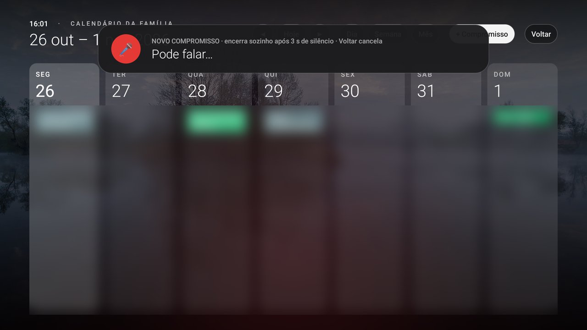 | 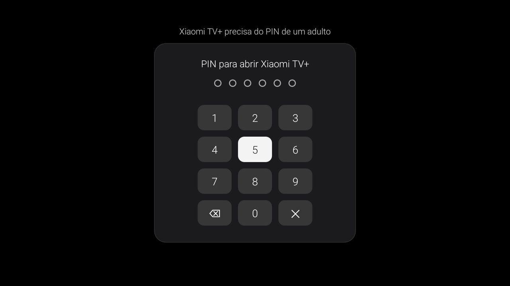 |

### Adult profile

| Home: dock, clock, Inputs, Calendar, Wi-Fi, Settings, Family | All apps |
|---|---|
| 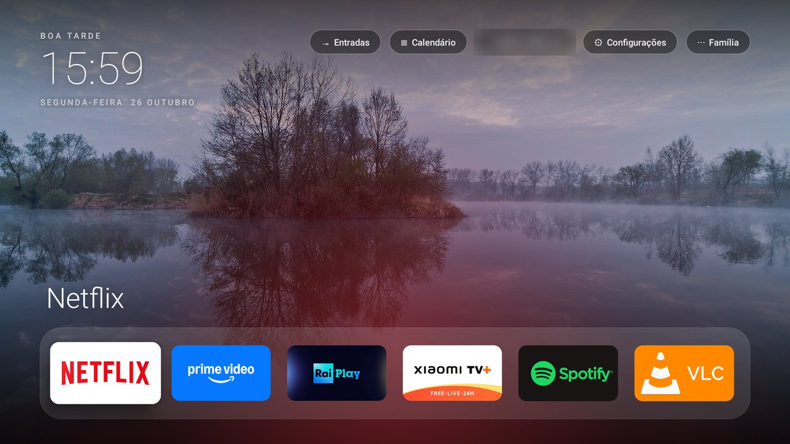 | 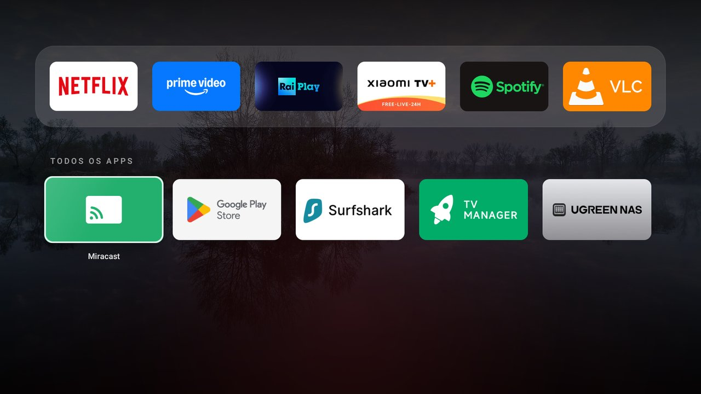 |

| Inputs menu (HDMI, AV, live TV) | Family menu (lock now, calendars shown without PIN, change PIN) |
|---|---|
| 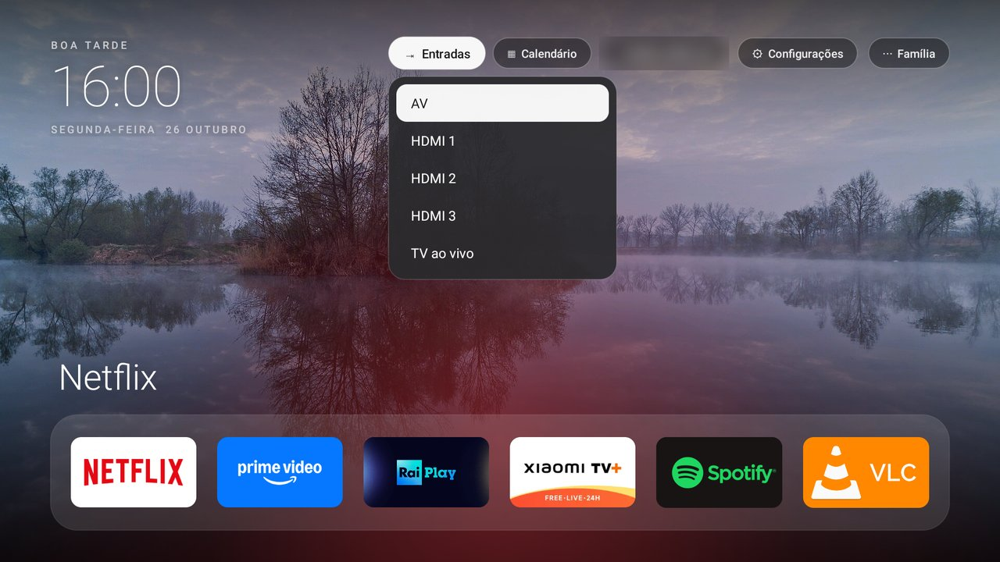 | 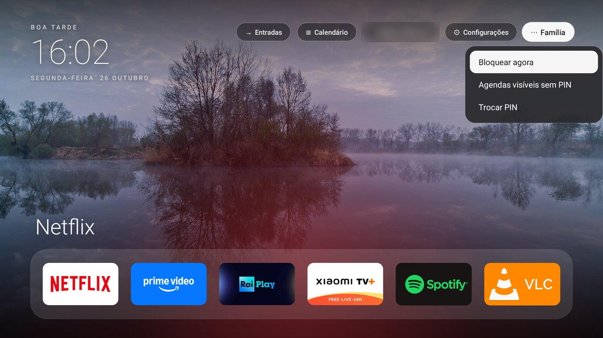 |

### Kids profile

Only the allowed apps, the time left and a way out. (Captured on an earlier build; the current one
also has the Calendar button next to Inputs.)

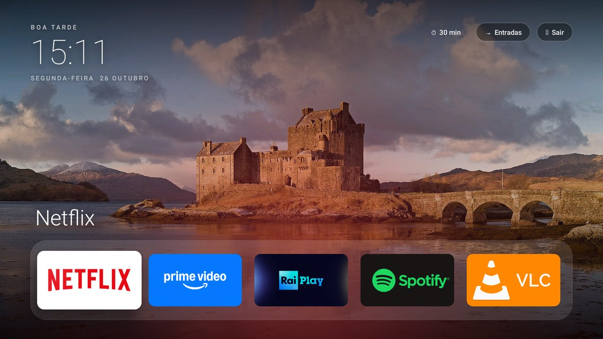

## What changed compared with the upstream repo

| Area | Upstream | This fork |
|---|---|---|
| Target | TCL Google TV, Android 11, macOS | Xiaomi Android TV 10 (API 29), Windows 11 |
| Build | `launcher/build-and-install.sh` (Homebrew JDK/SDK) | [`launcher/build-windows.sh`](launcher/build-windows.sh): API 29, no Gradle, no `zip` (Python), grants permissions and enables the guard over ADB |
| Apply / undo | `tools/disable.sh`, `tools/restore.sh` (Python ADB client) | [`tools/apply-windows.sh`](tools/apply-windows.sh), [`tools/restore-windows.sh`](tools/restore-windows.sh) (plain `adb`) |
| Home screen | Dock + all apps | Same, plus the locked calendar screen, profiles, Calendar and Family buttons |
| Parental control | none | PIN profiles, kids allow-list and timer, accessibility-based PIN gate |
| Calendar | none | Read-only week/day/month views, voice-created events |
| Language | English UI | Brazilian Portuguese UI |

### New launcher code ([`launcher/src/com/mihir/tvhome/`](launcher/src/com/mihir/tvhome/))

| File | What it does |
|---|---|
| `Profiles.java` | Current profile (locked / adult / kids), salted SHA-256 PIN, lockout after 5 wrong tries (1 min, doubling up to 15 min), kids' timer alarms, apps let through by a PIN |
| `PinPad.java` | On-screen 3×4 keypad for the D-pad; the remote's number keys also work |
| `CalendarScreen.java` | Calendar views from the local calendar provider, chooser for which calendars appear without a PIN, confirmation and insert for new events |
| `EventParser.java` | Turns a short Portuguese sentence into title, date and time (hoje/amanhã, weekdays, "dia 5 de novembro", "3/12", "18h30", "9 e meia", "8 da noite", "meio-dia") |
| `VoiceCapture.java` | Speech input through the TV's Google speech service with live text and a 3 s silence cut-off; falls back to the system voice screen |
| `KidsTimer.java` | 5-minute warning and end of the kids' session, bringing the calendar back over any app |
| `HomeApp.java` | Locks the profiles when the TV goes to standby |
| `Guard.java`, `GateActivity.java` | Accessibility service that only reads the package name of the app coming to the front, and the full-screen PIN prompt it opens |

Lists live in [`launcher/res/values/config.xml`](launcher/res/values/config.xml): dock, kids' apps,
always-PIN apps (YouTube), protected apps (Settings, Play Store, TV Manager), kids' session lengths.

## How the parental control works

| | Locked (calendar) | Kids | Adult |
|---|---|---|---|
| Apps on the kids' list | PIN | open | open |
| Other apps with an icon (e.g. Xiaomi TV+ from the Mi key) | PIN | PIN | open |
| Settings, Play Store, TV Manager | PIN | PIN | open |
| YouTube | PIN | PIN | PIN |
| Add a calendar event by voice | yes | no | yes |

- The right PIN lets that one app through until the home screen comes back; Back or ✕ goes home.
- The adult profile locks when the TV goes to standby or after 4 hours without using the home screen.
- The PIN is stored only on the TV, as a salted hash in the launcher's private storage. Forgot it?
  `adb shell pm clear com.mihir.tvhome`, run `launcher/build-windows.sh --install` again (it re-grants
  the permissions and re-enables the guard), set the launcher as home and create a new PIN on the TV.
- The launcher has no network access of its own. The calendar is read from what the TV already syncs
  for the signed-in Google account; new events go to that account's primary calendar.

Other layers used on this TV, all from the stock menus: the TV's own parental controls for broadcast
TV (ratings above 9 years blocked), Play Store family controls (PEGI 7), kids profiles with PINs in
Netflix and Prime Video.

### Known limits

- The remote's microphone key is always handled by Google (`keycode 219` → `com.google.android.katniss`);
  voice events start from the "+ Compromisso" button instead.
- Gemini is not available for Android TV 10 sets; it can't replace Google Assistant here.
- "4 hours without use" counts from the last time someone used the home screen, not the remote inside
  other apps.
- Broadcast programmes without a rating and the HDMI inputs are not blocked (a family choice).
- A factory reset removes everything, as on any non-rooted TV.

## Debloat on this TV

21 packages are disabled (18 by this project, 3 were already disabled). The commented list with the
reason for each one is [`versoes/debloat-v1.txt`](versoes/debloat-v1.txt); package snapshots before
and after are in [`backups/`](backups/).

| Group | Packages |
|---|---|
| Telemetry and promos | `com.miui.tv.analytics`, `com.xiaomi.statistic`, `android.autoinstalls.config.xiaomi.amelie`, `fusion.android.tv.demo`, `com.google.android.feedback`, `com.google.android.tv.bugreportsender` |
| Unused apps | Google Play Movies, Play Games, Amazon Alexa, Mi Channel, Xiaomi WallPaper, manual, Media Player, Gallery, Mi Music |
| Recommendations and launchers | `com.google.android.tvrecommendations`, `com.google.android.tvlauncher` (replaced), `com.mitv.tvhome.atv` (PatchWall) |

Kept on purpose: Google Play services, Play Store, Chromecast (`mediashell`), voice search (`katniss`),
Xiaomi updates, the MediaTek tuner and inputs, TV settings and keyboard, and
`com.xiaomi.android.tvsetup.partnercustomizer`, which handles the remote's special keys (the Mi key
opens Xiaomi TV+ through it, not through PatchWall).

Notes from this TV:

- With `com.google.android.tvlauncher` enabled, `set-home-activity` succeeds but Home still opens it
  (system priority). It has to be disabled, and only after the new launcher is tested, because the
  set also ships a factory-test launcher (`com.duokan.factorytest`) that would take Home.
- On Android 10 the launcher needs location permission to read the Wi-Fi name.
- Ending the kids' session over another app needs `SYSTEM_ALERT_WINDOW` (granted over ADB).
- In Git Bash, `/sdcard/...` paths get rewritten into Windows paths: use `MSYS_NO_PATHCONV=1`.
  `adb exec-out screencap` returned a broken file; `screencap` to `/sdcard` plus `adb pull` works.

## Do it on Windows

Needs: Android SDK Platform-Tools (`adb`), Python 3, Git Bash or MSYS2, JDK 17 and the Android SDK
command-line tools with `platforms;android-34` and `build-tools;34.0.0`. On the TV: Settings → Device
Preferences → About → press OK on **Build** 7 times → Developer options → USB debugging on.

```bash
echo 192.168.1.50 > privado/tv-ip.txt            # your TV's IP; privado/ is git-ignored
adb connect 192.168.1.50:5555                    # accept "Allow USB debugging?" on the TV
export JAVA_HOME="C:/Program Files/Eclipse Adoptium/jdk-17.0.20.101-hotspot"
launcher/build-windows.sh --install              # build + install, Home unchanged
tools/apply-windows.sh versoes/debloat-v1.txt    # disable the list, set Home, enable the guard
```

Undo everything:

```bash
tools/restore-windows.sh versoes/debloat-v1.txt  # re-enable the list, stock Home, guard off
adb uninstall com.mihir.tvhome
```

Read the list before applying it: it was made for this household (no Alexa, no USB media apps) and
for this model. Turn USB debugging off when you're done.

## Versions

Each change on the TV got a version and a commit:

| Version | What |
|---|---|
| v0.6 | Package backup before any change |
| v0.7 / v0.8 / v0.9 | Debloat groups A (telemetry), B (unused apps), C (recommendations) |
| v0.11 / v0.12 | Adapted launcher on Home; stock launcher and PatchWall disabled |
| v0.15 | Family calendar, profiles with PIN, kids' timer, events by voice |
| v0.16 | PIN gate (accessibility service) |
| v0.17 | Restore test, final backup, Windows apply/restore scripts, this README |

---

The upstream README follows, unchanged.

## Upstream: tv-home

**Make a slow, ad-filled Android TV fast and clean again.** Debloat it over Wi-Fi and give it a
tiny Apple TV-style home screen with rotating nature wallpapers. You can hand the whole thing to
Claude Code with one prompt, or do it by hand with the scripts here.


On a 2 GB TCL Google TV this disabled 25 bloat apps and cut the home screen's memory use from
192 MB to 83 MB. Everything is reversible: packages are disabled, never uninstalled.

### Do it with Claude Code (easiest)

1. On the TV: Settings → System → About → press OK on **Build** 7 times → back → Developer options
   → turn on **USB debugging**. Keep the TV on, on the same Wi-Fi as your computer.
2. Clone this repo, open Claude Code inside it (so it can reuse the launcher and scripts), and paste:

   ```text
   My Android TV is slow and full of ads. Find it on my Wi-Fi, connect over ADB, and debloat it:
   disable the manufacturer's ads, telemetry and junk (reversibly, never uninstall), asking me first
   about apps and features I might use. Then build and install a fast, minimal Apple TV-style home
   screen with a dock of my favourite apps and rotating nature wallpapers. Back up before changing
   anything, check every step with screenshots from the TV, and give me a restore script.

   Heads-up from people who've done this: use the adb-shell Python package if macOS blocks adb; on
   Google TV also disable com.google.android.tungsten.setupwraith or it hijacks the Home button; and
   test the Home button from inside an app.
   ```

3. Accept "Allow USB debugging?" on the TV when asked, then answer a few questions: which apps you
   use, which go in the dock, whether you want wallpapers.

The prompt is short on purpose; Claude works out the details. The gotchas below are there in case it gets stuck.

### Do it by hand (macOS)

```bash
./setup.sh                                                  # Python ADB client, JDK 17, Android SDK
tools/find-tv.sh                                            # finds the TV, saves its IP
tools/venv/bin/python -I tools/tv.py --probe                # model, Android version
tools/disable.sh examples/tcl-google-tv-g07/debloat.txt     # or your own list, see examples/
launcher/build-and-install.sh                               # build + install the launcher
```

Undo everything with `tools/restore.sh <the same list>`.

### What's here

| Path | What it is |
|---|---|
| [PROMPT.md](PROMPT.md) | The prompt for Claude Code / any coding agent |
| [launcher/](launcher/) | The home screen. 4.7 MB including the wallpapers; plain Android, no network, no background services |
| [launcher/res/values/config.xml](launcher/res/values/config.xml) | Dock apps, hidden apps, Live TV app, grid columns |
| [tools/tv.py](tools/tv.py) | Pure-Python ADB client: shell, batch, screenshots, chunked APK push |
| [tools/find-tv.sh](tools/find-tv.sh) | Finds Android TVs on your Wi-Fi |
| [tools/type.sh](tools/type.sh) | Type into the TV's on-screen keyboard from your laptop (`tools/type.sh` alone prompts hidden, for passwords) |
| [tools/disable.sh](tools/disable.sh), [tools/restore.sh](tools/restore.sh) | Apply / undo a debloat list |
| [examples/](examples/) | Debloat lists per TV model |

### The launcher

- Clock, greeting and date top-left. Frosted pills top-right for **Inputs** (HDMI/AV/Live TV
  dropdown; the remote's Menu key opens it too), **Wi-Fi** (shows the network name) and **Settings**.
- A dock of your favourite apps. The focused app's name appears above it over a glow coloured from
  its banner. Press Down for every other app in a grid.
- 12 nature photos crossfade every 10 minutes, with a scrim so text stays readable. Swap them in
  `launcher/assets/wallpapers/` (1920×1080 JPEGs, credits in `launcher/WALLPAPER-CREDITS.md`).
- Deterministic D-pad focus, remembers the last tile, picks up newly installed apps on return.

Change the dock: edit `config.xml`, then run `launcher/build-and-install.sh`.

### Gotchas we hit

- **macOS blocks the `adb` binary** on the local network ("No route to host"). `tools/tv.py` uses
  the `adb-shell` Python package instead.
- **Google TV hijacks the Home button.** With the stock launcher disabled, the setup app
  (`com.google.android.tungsten.setupwraith`) has a higher HOME priority than any third-party
  launcher. The install script disables it; `restore.sh` re-enables it.
- **Home opened the launcher behind the current app**, because of a stale home task from switching
  launchers. Force-stopping the launcher and `com.android.tv.settings` and pressing Home fixes it.
  The install script does this.
- **Chained `pm` commands** (`pm disable a; pm disable b`) can silently stop after the first. The
  scripts run one per shell call.
- **Apps installed from the Play Store didn't appear**, because the package broadcast was missed
  while another app was in front. The launcher re-checks with `getChangedPackages` on every return.
- **Unsplash blocks scripted downloads** with a bot check. The wallpapers come from Wikimedia
  Commons Featured Pictures instead.

### Supported TVs

Android TV and Google TV: TCL, Xiaomi/Redmi, Hisense, Sony, OnePlus, Realme, Nvidia Shield,
Chromecast with Google TV and most others. Not Samsung (Tizen), LG (webOS) or Fire TV.
Tested on: TCL Google TV (Android 11). Add yours to `examples/`.

### Credits

Inspired by [Gathin23/tv-vibehack](https://github.com/Gathin23/tv-vibehack). Wallpaper photos are
from Wikimedia Commons under their own licences, see
[launcher/WALLPAPER-CREDITS.md](launcher/WALLPAPER-CREDITS.md). Code is MIT, see [LICENSE](LICENSE).
